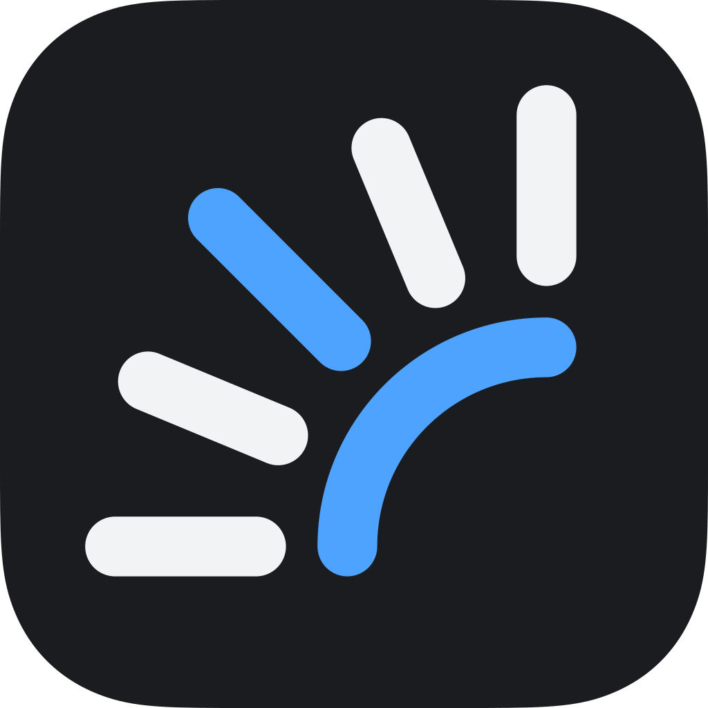
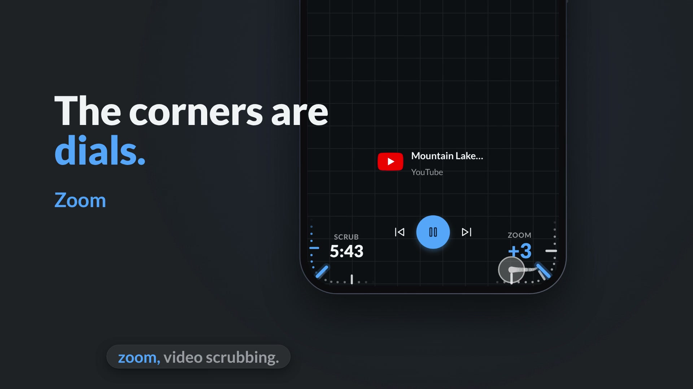
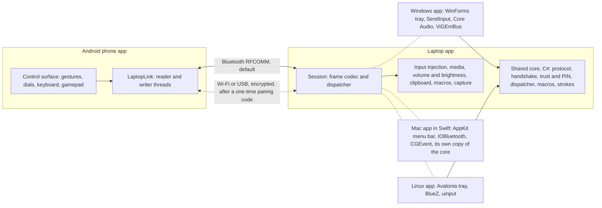
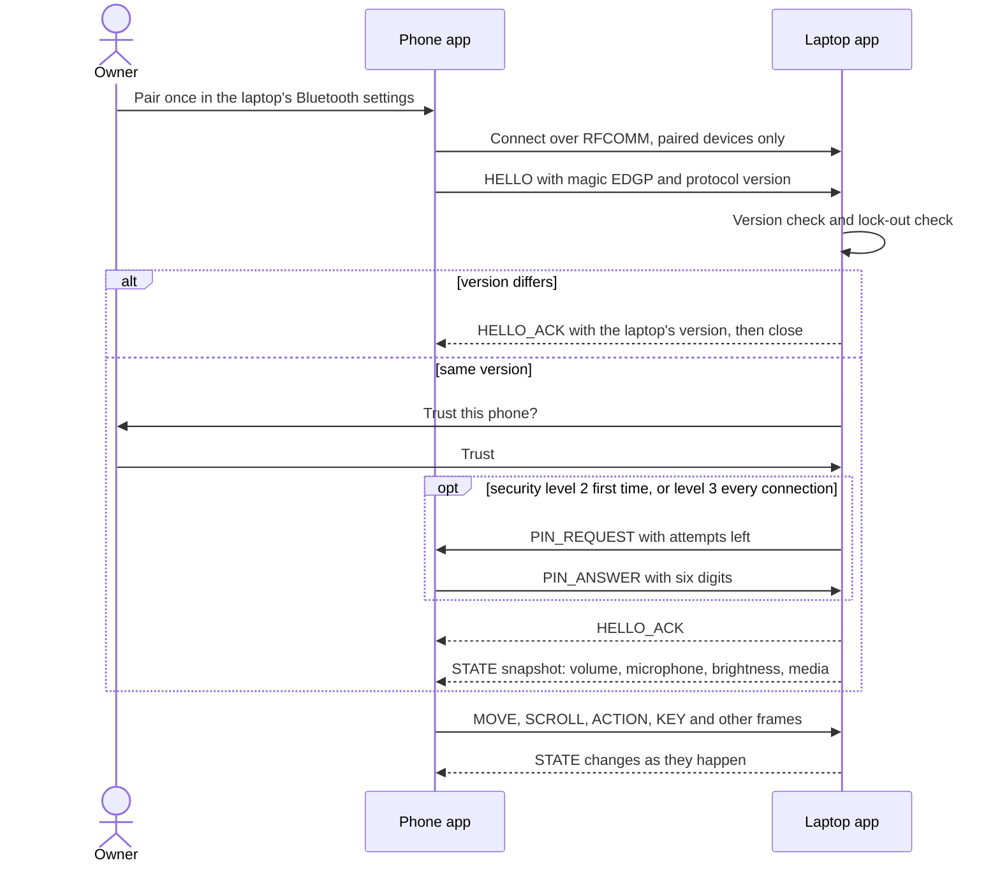

<p align="center"><picture><source media="(prefers-color-scheme: dark)" srcset="assets/edgepad-light.svg"></picture></p>

<h1 align="center">Edgepad</h1>

<p align="center">Turn an Android phone into a trackpad, a media remote and a control panel for a Windows, Mac or Linux laptop, over a direct Bluetooth link with nothing in between.</p>

<p align="center">
<a href="https://github.com/akshit-bansal11/edgepad/actions/workflows/ci.yml"></a>
<a href="https://github.com/akshit-bansal11/edgepad/releases/latest"></a>
<a href="https://github.com/akshit-bansal11/edgepad/releases"></a>
<a href="https://github.com/akshit-bansal11/edgepad/stargazers"></a>
<a href="LICENSE"></a>
<a href="https://github.com/akshit-bansal11/edgepad/commits/main"></a>

<a href="https://edgepad.akshitbansal.dev/docs"></a>
</p>

<p align="center"><a href="https://edgepad.akshitbansal.dev/#demo"></a></p>

## Contents

- [Why Edgepad](#why-edgepad)
- [Features](#features)
- [What people say](#what-people-say)
- [Install](#install)
- [Quick start](#quick-start)
- [How it works](#how-it-works)
- [Languages](#languages)
- [Security](#security)
- [Develop](#develop)
- [Contributing](#contributing)
- [Support](#support)
- [License](#license)
- [Credits](#credits)
- [Star history](#star-history)

## Why Edgepad

It is for the times the laptop is across the room rather than under your hands: plugged into a television, docked on a desk you are not sitting at, parked somewhere a mouse dongle will not reach. The alternatives are a remote app that only sends media keys, or a remote-desktop app that streams the whole screen and wants an account and a network round trip to change the volume. Edgepad is neither. The phone and the laptop pair once, the way a headset does, and after that they talk directly: no account, no service in between, and over Bluetooth no Wi-Fi at all. The cost is Bluetooth's own: both ends need it, and it does not reach another room or the internet. Wi-Fi and USB connections are optional, off until you turn them on, and use a one-time code.

> [!WARNING]
> **Mac and Linux are still in testing. Please use them at your own risk.** The Windows app is the one that has been run on a real laptop; the Mac app has been compiled and unit-tested in CI, and the Linux app has not been seen working on a Linux laptop yet. Expect rough edges, and report what you find.

## Features

**The control surface**

- **Corner rulers.** Each corner holds a dial drawn as a ruler that wraps the bend: volume, brightness, media scrub, zoom, app switcher, refresh rate, scroll, desktops, browser tabs or the Devices dial. Split corners give each corner two dials.
- **Trackpad and gestures.** One finger moves and clicks, two scroll and pinch, three and four fingers run actions you assign. Hold still, then draw a shape to run an action or a macro.
- **Media.** The track, the app playing it and where it is, with previous, play/pause and next.
- **Live state.** The dials show the laptop's real volume, mute, brightness and playback position.

**Controls**

- **Keyboard and Type text.** A full on-screen keyboard, and a field that sends whole text to the laptop.
- **Gamepad.** A virtual Xbox controller with analog sticks and triggers where a driver exists, key presses where it does not; layouts you build and keep per game.
- **Macros.** Buttons that open a program, file, folder or web address on the laptop.
- **Annotate and sign.** The phone as an absolute pen on the laptop's screen, or as a signature pad.
- **Capture.** Region screenshot, whole screen and screen recording, optionally saved to the phone.

**Sharing**

- **Shared clipboard.** Text and images copied on the laptop arrive on the phone; the phone's copy is sent when you return to Edgepad.
- **Share > Edgepad.** Send one text or image from any Android app, after a confirm screen that names the laptop.

**And**

- **15 languages** on the phone and the Windows app.
- **Security levels.** Trust the phone once, or add a six-digit PIN once per phone or on every connection.
- **Light or dark, upright or sideways,** and a first-run guide.

Details of each are in the [user guide](docs/USER-GUIDE.md).

## What people say

> For years I looked for a way to sync the clipboard between my phone and my laptop over Bluetooth, and never found one I was happy with — until Edgepad. It treats the Bluetooth link as a first-class part of the product, and the features built on top of it are inventive, genuinely useful, and put together in a way that feels coherent and looks good. It went far beyond what I expected.
>
> ★★★★★ 5/5 — [@HaujetZhao](https://github.com/HaujetZhao), a daily user ([source](https://github.com/akshit-bansal11/edgepad/issues/63))

## Install

Get both apps from the [latest release](https://github.com/akshit-bansal11/edgepad/releases/latest), under **Assets**. Each file is named for its release. **Install the phone and the laptop app from the same release:** the two refuse each other at the handshake when their protocol versions differ, and say so.

| Where | Needs | Download | Note |
| --- | --- | --- | --- |
| Phone | Android 12 or later | `Edgepad-<version>.apk` | Allow installing from this source. Later releases install over it, and the app can fetch them itself. |
| Windows laptop | Windows 10 version 2004 or later, 64-bit | `Edgepad-<version>.exe` | One self-contained file. Not code-signed, so SmartScreen asks: **More info**, then **Run anyway**. |
| Mac laptop | macOS 13 or later | `Edgepad-<version>-mac.zip` | Apple Silicon and Intel. Ad hoc signed, not notarised: **Open Anyway** in System Settings. In testing. |
| Linux laptop | 64-bit, BlueZ, systemd-logind | `Edgepad-<version>-linux-x64.tar.gz` | Run `install.sh` as root, then log out and back in once. In testing. |

Releases also carry `SHA256SUMS.txt`, and `gh attestation verify <file> --repo akshit-bansal11/edgepad` checks that a file was built by this repository's release workflow. Full steps for every platform, the optional ViGEmBus gamepad driver and the Linux requirements are in the [user guide](docs/USER-GUIDE.md#install).

## Quick start

1. Install the phone app and one laptop app from the same release (above) and start the laptop app. It lives in the system tray, or on a Mac in the menu bar.
2. Pair the phone with the laptop once in the laptop's Bluetooth settings, and confirm the code on both sides.
3. Open Edgepad on the phone and tap the laptop.
4. The first time, the laptop asks **Trust this phone?**. Choose **Trust** there.
5. Use the corners and the trackpad. The phone remembers the laptop and reconnects when the app opens.

More on connecting, Wi-Fi and USB, and what to do when the laptop ignores the phone is in the [user guide](docs/USER-GUIDE.md).

## How it works

The phone recognises gestures and sends small semantic frames (move the pointer, press a button, run action 3, set control 0 to 55). The laptop owns the table of what each action does and carries it out with the platform's own APIs, then reports its state back so the dials show real values. The default link is Bluetooth Classic RFCOMM between two already-paired devices; the optional Wi-Fi or USB link is encrypted and starts with a one-time pairing code.



A first pairing and connection over Bluetooth. Trust comes before the PIN, and the PIN gate runs only when the laptop's security level asks for it.



Read more: [docs/ARCHITECTURE.md](docs/ARCHITECTURE.md) for the apps, their threads and the trust model, [docs/PROTOCOL.md](docs/PROTOCOL.md) for the wire format, and the [online documentation](https://edgepad.akshitbansal.dev/docs).

## Languages

Edgepad speaks English plus Simplified Chinese, Spanish, Hindi, German, French, Portuguese (Brazil), Japanese, Arabic, Russian, Korean, Italian, Dutch, Turkish and Polish: 15 in all, on the phone app and the Windows app. The phone follows the system language, and on Android 13 and later Edgepad can have its own language in Android's per-app language settings. Windows follows its display language. Translators: see [docs/i18n/README.md](docs/i18n/README.md).

## Security

Only a phone that is paired with the laptop can connect, and only a phone you answer **Trust** for is admitted. Every trusted phone has full keyboard-level control of the laptop, so trust only your own. An optional PIN, set on the laptop only, adds a lock-out against guessing. There is no server, no account and no telemetry. The boundaries and the known limits are in [SECURITY.md](SECURITY.md) (report a hole privately, as it describes); the levels and the PIN are explained in the [user guide](docs/USER-GUIDE.md#security-levels-and-the-pin).

## Develop

You need JDK 17 and the Android SDK for the phone, the .NET SDK pinned in `global.json` for Windows and Linux, a Mac with Xcode for the Mac app, Node 24 or later for the site, and PowerShell 7 for the gate. Install only what the part you are changing needs. One command checks everything it can run:

```powershell
pwsh scripts/check.ps1                  # formats in place, then checks everything
pwsh scripts/check.ps1 -Ci              # what CI runs: fails on unformatted code instead of fixing it
```

The repository layout, per-app gates, how to run it locally and what the tests cover are in [docs/DEVELOPING.md](docs/DEVELOPING.md); how to send a change back is in [CONTRIBUTING.md](CONTRIBUTING.md).

## Contributing

- **A bug, or something Edgepad should do:** [open an issue](https://github.com/akshit-bansal11/edgepad/issues/new/choose). The bug report and feature request templates ask for what is needed to act on it. Open one before starting anything bigger than a fix, so the design can be talked through before code exists.
- **A security hole:** report it privately, as [SECURITY.md](SECURITY.md) describes, not in a public issue.
- **Someone behaving badly:** everyone here is held to the [code of conduct](CODE_OF_CONDUCT.md), and it says how to report a breach privately.
- **A change:** make it on a branch of your fork, run the gate until it is clean, push the branch to your fork and open a pull request against `main` here. CI runs the gate on every app for every pull request, and the site's gate when the site or the protocol fixtures change. [CONTRIBUTING.md](CONTRIBUTING.md) has the details: keeping the apps in step, tests, commit messages and style.

Releases are built and published by the maintainer; [CHANGELOG.md](CHANGELOG.md) lists what each one changed.

## Support

Edgepad is free and stays free. If it is useful to you and you would like to say so with money, there are three ways:

- **[Ko-fi](https://ko-fi.com/akshit_bansal11)**, from anywhere.
- **[PayPal](https://paypal.me/AkshitBansal141)**, from anywhere.
- **UPI**, from any UPI app in India: `artistbansal2004@okaxis`

A star, a bug report or telling someone about it helps as much.

## License

[MIT](LICENSE).

## Credits

- Thanks to [@HaujetZhao](https://github.com/HaujetZhao) for asking for the translations ([#63](https://github.com/akshit-bansal11/edgepad/issues/63)) and for Type text on the control surface ([#65](https://github.com/akshit-bansal11/edgepad/issues/65)), both laid out so clearly they were straightforward to build, and for the review above.
- The phone app's icons are Edgepad's own, drawn for it (24 px grid, 1.5 stroke, round caps). The desktop apps' icons are [Lucide](https://lucide.dev), ISC licence; the few that came from Feather are MIT. The desktop apps draw Lucide's own paths, and the licence text ships inside the exe beside the icons. The APK also carries it as `assets/licenses/Lucide-LICENSE.txt`, because the app logo's music note is still Lucide's.
- The typeface is [Lato](https://www.latofonts.com), by Łukasz Dziedzic, SIL Open Font License 1.1. Both apps bundle it, and its licence ships inside the APK as `assets/licenses/Lato-OFL.txt` and inside the exe beside the fonts. The website also sets code in [JetBrains Mono](https://github.com/JetBrains/JetBrainsMono), under the same licence.
- The media players' logos (Spotify, Netflix, YouTube and the rest, in `android/app/src/main/res/raw`) are trademarks of their owners. The phone shows one only to say which app is playing on the laptop; that implies no endorsement by, or affiliation with, any of them. The SVG files were supplied by the maintainer and are drawn as supplied.
- The Windows app uses [NAudio](https://github.com/naudio/NAudio) (MIT), `System.Management` and [Nefarius.ViGEm.Client](https://github.com/nefarius/ViGEm.NET) (MIT); the Linux app uses [Avalonia](https://avaloniaui.net), Avalonia.Desktop and Avalonia.Themes.Fluent (12.1.4, MIT) and Tmds.DBus.Protocol (0.94.1, MIT), each licence read from the package's nuspec; Avalonia also brings SkiaSharp (3.119.4) and HarfBuzzSharp (8.3.1.3) with their `NativeAssets.Linux` packages (MIT), whose native libraries are bundled into the Linux app and compile in Skia, HarfBuzz, FreeType, libpng, zlib and other code under its own licences, listed in those packages' `THIRD-PARTY-NOTICES.txt`; the phone app uses [AndroidSVG](https://github.com/BigBadaboom/androidsvg) (Apache 2.0). The notices of every package each desktop app bundles, and of the .NET runtime, are written by `scripts/notices.sh` at build time: embedded in the exe as `THIRD-PARTY-NOTICES.txt`, and in the Linux archive under `licenses/`. [ViGEmBus](https://github.com/nefarius/ViGEmBus) (BSD 3-Clause) is a separate install and is not distributed with Edgepad.

## Star history

[](https://star-history.com/#akshit-bansal11/edgepad&Date)
