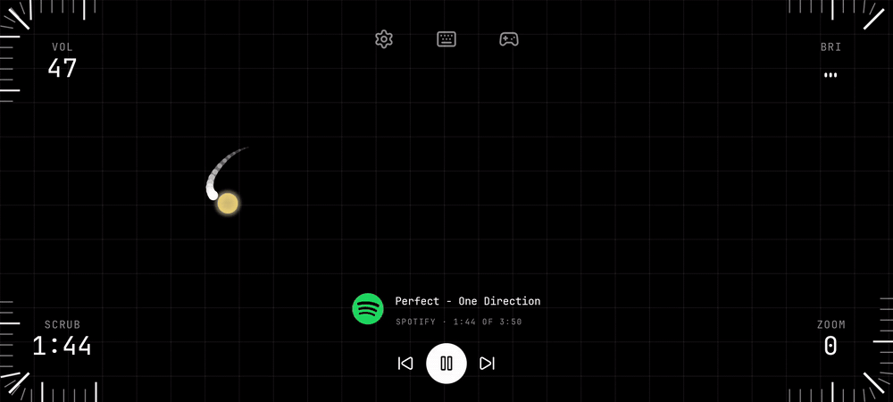

<p align="center"><picture><source media="(prefers-color-scheme: dark)" srcset="assets/edgepad-dark.svg"></picture></p>

# Edgepad

Edgepad turns an Android phone into a trackpad, a media remote and a control panel for a Windows laptop, a Mac or a Linux laptop, over a direct Bluetooth link with nothing in between.

<p align="center"></p>

<p align="center"><sub>The phone's screen. The finger crosses the trackpad, then slides the corner ruler and the volume follows.</sub></p>

It is for the times the laptop is across the room rather than under your hands: plugged into a television, docked on a desk you are not sitting at, parked somewhere a mouse dongle will not reach. The alternatives are a remote app that only sends media keys, or a remote-desktop app that streams the whole screen and wants an account and a network round trip to change the volume. Edgepad is neither. The phone and the laptop pair once, the way a headset does, and after that they talk directly: no account, no Wi-Fi, no service in between that can be slow or down. The cost is Bluetooth's own — both ends need it, and it does not reach another room or the internet.

**Mac and Linux are still in testing. Please use them at your own risk.** The Windows app is the one that has been run on a real laptop; the Mac app has been compiled and unit-tested in CI, and the Linux app has not been seen working on a Linux laptop yet. Expect rough edges, and report what you find.

[](https://github.com/akshit-bansal11/edgepad/actions/workflows/ci.yml)
[](https://github.com/akshit-bansal11/edgepad/releases/latest)
[](LICENSE)
[](https://edgepad.akshitbansal.dev)

## What it does

- **Corner rulers.** Each corner of the phone holds a dial drawn as a ruler that wraps the bend. Slide along it, clockwise to raise. Volume, brightness, media scrub, zoom, app switcher or microphone level; Settings picks what each corner does, how long the rulers are and how tall. **Split corners** in Settings › Corners gives each corner two dials, one on each edge it joins, eight in all.
- **Trackpad.** Everything between the corners moves the laptop's pointer. One finger moves and clicks, two scroll and pinch, three and four fingers do whatever you assign them: desktops, task view, media, volume, app switcher, and more. Press one finger and hold it still until it ticks, then draw without lifting: a shape you have drawn in Settings runs a laptop action, a macro, or hides or locks the pad itself. A stroke that matches nothing does nothing.
- **Media.** The track, the app playing it and where it is, with previous, play/pause and next. Drag the three pieces anywhere on the surface.
- **Controls.** One button on the surface opens a grid of the keyboard, the gamepad, capture and annotate; the grid can be rearranged like the macro deck.
- **Keyboard and gamepad.** A full on-screen keyboard whose modifiers work held or tapped, and a gamepad that drives a real virtual Xbox controller on the laptop, sticks and triggers analog, where the [ViGEmBus](#install) driver is installed; where it is not, the same pad falls back to pressing keys and says so. Every control is yours to add, bind, label, size, move or delete, and layouts are a library rather than one arrangement, so a phone can keep one per game. Both open sideways. On Linux the gamepad plugs in a virtual Xbox 360 controller; the Mac has no controller driver, so there it presses keys.
- **Annotate and sign.** The phone becomes an absolute pen for the laptop's screen: a touch lands at the same place on the laptop. Pen, highlighter, line, arrow, rectangle and ellipse in eight colours, with Undo and Clear. The **Sign** switch turns the same pad into a signature pad: nothing is drawn on the laptop, and **Save signature** copies a transparent PNG to the clipboard and saves it (see [Annotate and sign](#annotate-and-sign)). Primary display only.
- **Capture.** Buttons for a region screenshot, the whole screen and a screen recording, which press the laptop's own shortcut (see [Capture](#capture)).
- **Macros.** A grid of buttons that open a program, file, folder or web address on the laptop. In the macro bar, **Edit layout** lets you drag the buttons into the order you want and pick the grid (3 × 2, say) from a list; the phone still sends only the slot number.
- **Live state.** The dials show the laptop's real volume, mute, brightness and playback position, and follow changes made on the laptop itself.
- **Guide.** Five pages on the first run, and again from Settings, one at a time or on one page.
- Black on white or white on black, and upright or sideways: both are toggles in Settings. The orientation applies to every screen but the keyboard and the gamepad, which are always sideways.

## Install

Both apps come from the [latest release](https://github.com/akshit-bansal11/edgepad/releases/latest), under **Assets**. Each file is named for its release, so `Edgepad-3.1.1.exe` and `Edgepad-3.1.1.apk` are the two halves of 3.1.1; on a Mac the laptop half is `Edgepad-<version>-mac.zip`, from 3.4.0, and on Linux `Edgepad-<version>-linux-x64.tar.gz`, from 4.0.0. Always install both from the same release: the two refuse each other at the handshake when their protocol versions differ, and say so. 3.0.0 moved the protocol from version 3 to version 4, so a 2.x app on either side will not talk to a 3.x one — update both halves together or neither connects. 4.0.0 moves it to version 5, so a 3.x app will not talk to a 4.x one either. Releases after 3.1.1 also carry `SHA256SUMS.txt`, and `gh attestation verify Edgepad-<version>.apk --repo akshit-bansal11/edgepad` checks that a file was built by this repository's release workflow.

### Laptop (Windows 10 version 2004 or later, 64-bit)

1. Download `Edgepad-<version>.exe`. It is a single self-contained file; nothing else needs installing.
2. Run it. It is not code-signed, so SmartScreen asks first: choose **More info**, then **Run anyway**.
3. It lives in the system tray, and a left or a right click on its icon opens the same menu. The menu shows whether a phone is connected, then **Start with Windows**, **Macros…**, **Open log**, **Documentation**, **Forget trusted phones** and **Quit Edgepad**, with the version beside it. It follows Windows' light or dark app mode.

Running a newer release's exe asks the running copy to quit and takes its place. From 3.3.0 the tray app asks GitHub once a day whether a newer release exists, and shows an **Update available** row at the top of its menu when one does.

**Optional, for the gamepad: ViGEmBus.** The gamepad works without it — every control can be bound to a keyboard key, and keys are what the pad sends on a laptop with no controller driver, which is the state most laptops are in. Install [ViGEmBus](https://github.com/nefarius/ViGEmBus/releases/latest) and Edgepad plugs a virtual Xbox controller into Windows instead, so the sticks and triggers carry their full analog range and a game that only ever accepted a controller can be played from the phone. It is a third-party kernel driver, signed as Windows requires of one, and you install it yourself; Edgepad neither bundles nor installs it. You never have to guess which of the two you are in: the laptop answers every request for the controller, and the gamepad screen says **keyboard mode** and which of the three reasons it was, rather than being quietly dead.

### Laptop (Mac, macOS 13 or later)

One download covers Apple Silicon and Intel. The Mac app was compiled and unit-tested in CI before its first run on a real Mac, so expect rough edges and report them.

1. Download `Edgepad-<version>-mac.zip` and unzip it. It holds `Edgepad.app`; move that to Applications.
2. Open it. It is ad hoc signed and not notarised, because the project has no Apple Developer ID, so macOS refuses an app it does not recognise. Open **System Settings > Privacy & Security** and choose **Open Anyway** for Edgepad.
3. It lives in the menu bar. It asks for **Bluetooth**, to listen for the paired phone, and for input control (**System Settings > Privacy & Security > Device Control and Data Access**, named Accessibility before macOS 27). Without it macOS silently discards every pointer move and key press the app sends, and the menu shows **Allow Edgepad to control this Mac…** until it is granted. On macOS 27 the system never lists the app on its own: in that pane click **+**, add Edgepad, and switch it on (including its Events switch where one is shown). If input still does nothing after you grant the permission, quit Edgepad from the menu bar and open it again.
4. The menu shows whether a phone is connected, then **Update available** when a newer release exists, **Start at login**, **Open log**, **Documentation**, **Forget trusted phones** and **Quit Edgepad**, with the version beside it. The app asks GitHub once at start and once a day whether a newer release exists, and downloads nothing.

Because the signature is ad hoc, macOS treats every new version as a different app, so the Device Control permission has to be granted again after each update: remove the old Edgepad entry in the list, then add the new one.

### Laptop (Linux, 64-bit)

**Still in testing; use it at your own risk.** [docs/LINUX.md](docs/LINUX.md) lists everything that has not been seen working.

1. Download `Edgepad-<version>-linux-x64.tar.gz` and check it against `SHA256SUMS.txt`.
2. Extract it and run the installer as root:

   ```sh
   tar xzf Edgepad-<version>-linux-x64.tar.gz
   cd edgepad-<version>
   sudo ./install.sh            # or: sudo ./install.sh /opt/edgepad  to install under another prefix
   ```

3. **Log out and back in once**, so your session gets access to `/dev/uinput`. Then start Edgepad from the launcher, or run `edgepad`.

`install.sh` only copies files and loads a module; it downloads nothing. It puts `edgepad` in `<prefix>/bin` (the prefix defaults to `/usr/local`), the launcher entry in `<prefix>/share/applications`, the icon in `<prefix>/share/icons/hicolor/scalable/apps`, a udev rule in `/etc/udev/rules.d/60-edgepad-uinput.rules` and `uinput` in `/etc/modules-load.d/edgepad.conf`, then runs `modprobe uinput` and reloads udev. Uninstall with `sudo ./install.sh --uninstall` (same prefix, if you gave one); your settings in `~/.config/edgepad` stay.

The app is a self-contained single file, so .NET need not be installed. It does need:

- **BlueZ** (`bluetoothd`) for the Bluetooth link.
- **PipeWire's `wpctl`, or `pactl`**, for the volume and microphone dials.
- **systemd-logind** (`loginctl`) for Lock and for brightness, and **`xdg-open`** (`xdg-utils`) for macros that open a file, folder or web address and for the tray's Open log and Documentation.
- Optional: **`wl-copy`** (`wl-clipboard`) on Wayland or **`xclip`** on X11, for typing text that is not plain ASCII.
- **GNOME needs the AppIndicator extension** to show the tray icon. Without a tray the app still serves phones that are already trusted, but the Security window is out of reach.

On Wayland, the layer annotate draws on runs under XWayland and the compositor may ignore its always-on-top request, so annotate is best effort: Edgepad offers it to the phone only when it can work, and the phone hides the Annotate tile otherwise. The shortcuts behind task view, show desktop, search, notifications and switching desktops differ per desktop; the GNOME and KDE tables were written from memory and are unverified, and on any other desktop those actions do nothing. Macros are a text file you edit by hand, `~/.config/edgepad/macros.txt`; there is no editor on Linux yet.

### Phone (Android 12 or later)

1. Download `Edgepad-<version>.apk` on the phone and open it. Allow installing from this source if asked.
2. On first run, allow the **Nearby devices** permission. Edgepad uses it to see the laptops paired with the phone; it never scans for new ones.
3. Every later release installs over the previous one; settings are kept. From 3.3.0 the app fetches them itself: **Settings › Help › Updates** says when a newer release exists, and a tap downloads and installs it. Update the laptop app to the same release.

## Use

1. Pair the phone with the laptop once, in Windows **Settings > Bluetooth & devices**, macOS **System Settings > Bluetooth** or your Linux desktop's Bluetooth settings, and confirm the code on both sides.
2. Keep Edgepad running in the laptop's tray, or on a Mac in the menu bar. On Linux the tray needs a desktop that shows StatusNotifier icons; GNOME needs the AppIndicator extension.
3. Open Edgepad on the phone and tap the laptop. The first time, the laptop asks **Trust this phone?**; choose **Trust** there (no answer within a minute counts as no). Every paired phone is asked about once, and each one you trust is remembered; **Forget trusted phones** in the tray or menu-bar menu forgets them all. One phone drives the laptop at a time: a trusted phone that connects takes over from the connected one, and the phone it replaced is refused for 30 seconds, so the two do not take the laptop back and forth. After that it can reconnect with Retry.
4. The phone remembers the laptop and reconnects when the app opens. If the link drops, the phone retries ten times, two seconds apart, and says so.

### The control surface

| Where | Touch | Laptop does |
| --- | --- | --- |
| A corner ruler | slide | turns that dial: clockwise raises |
| A corner ruler | tap | the dial's action: mute, play/pause, mic mute, task view, reset zoom |
| Anywhere else, one finger | move / tap / tap then hold-and-move | pointer / left click / drag |
| Anywhere else, one finger | press, hold still until it ticks, then draw | what that shape is bound to: an action, a macro, or the pad's own focus or lock |
| Two fingers | drag | scroll both axes |
| Two fingers | pinch / tap | zoom / right click, or what Settings assigns |
| Three or four fingers | tap, swipe up, down, left, right | what Settings assigns |
| Top centre | tap one of the four buttons | Settings, Controls (keyboard, gamepad, capture, annotate), the lock, the macro grid |
| Back | | leaves the surface; the link stays up |

Out of the box, three fingers left and right switch desktops, three up opens task view, three down shows the desktop, four fingers left and right walk the app switcher (Alt stays held while the fingers are down), and tapping searches or opens notifications. Every one of those is changed under **Settings > Trackpad**.

The lock in the middle of that row is the one button that changes the surface instead of opening a screen. One tap hides the dials and the media and leaves the trackpad; a second tap straight after locks the trackpad instead and puts the dials and the media back, so the phone can sit in a pocket or under a palm and answer only its rulers. Any later tap returns the whole surface. The mode is not stored: a phone that came back up silently locked would read as broken.

### Security levels and the PIN

Set in the laptop's tray or menu-bar menu under **Security…**, never from the phone.

1. **Level 1, the default.** You say yes to a phone once, as above.
2. **Level 2.** Each phone also enters a six-digit PIN the first time it connects.
3. **Level 3.** The phone enters the PIN on every connection.

The phone asks on its own keypad, so no keyboard app sees the digits; it never stores the PIN, and the screen cannot be captured. A wrong answer shows the attempts left; after five wrong answers the laptop refuses that phone for 30 seconds, doubling with each further five, up to an hour. The counters are kept in memory, so quitting the laptop app resets them. Changing the PIN or the level makes every phone enter the PIN again.

**A forgotten PIN can only be reset on the laptop**, with **Reset PIN and forget phones…**. That removes the PIN, goes back to level 1 and forgets every trusted phone, so each one is asked **Trust this phone?** again. A six-digit PIN is only a million values, so what stops guessing is the lock-out; it does not protect against someone who can copy the laptop's settings file. The laptop stores only a salted hash of it.

### Controls, annotate, sign and capture

**Controls** on the surface opens a grid of Keyboard, Gamepad, Capture and Annotate. A laptop shows only what it can do, so a phone shows no Annotate tile when the laptop does not offer it.

#### Annotate and sign

**Annotate** draws on the laptop's primary display, with the phone as an absolute pen. **Sign** is the same pad without the overlay; **Save signature** copies a transparent PNG to the clipboard and saves it as `signature-yyyyMMdd-HHmmss.png` in an `Edgepad` folder, never overwriting an earlier one:

| | Saved in | Notes |
| --- | --- | --- |
| Windows | `Pictures\Edgepad` | |
| Mac | `~/Pictures/Edgepad` | The clipboard gets the PNG and a TIFF. |
| Linux | `Pictures/Edgepad` (your `XDG_PICTURES_DIR`) | Annotate is best effort and in testing; see [docs/LINUX.md](docs/LINUX.md). |

#### Capture

Capture presses the laptop's own screenshot shortcut; the phone has a trackpad under the buttons to drag out the region.

| | Region | Whole screen | Recording |
| --- | --- | --- | --- |
| Windows | Win+Shift+S | PrtScn | Win+Shift+R (needs a recent Snipping Tool; unverified) |
| Mac | Cmd+Shift+4 | Cmd+Shift+3 | Cmd+Shift+5 |
| Linux | Print | Print | Ctrl+Shift+Alt+R on GNOME, Meta+Alt+R on KDE (unverified) |

### On a Mac

Pointer, click, drag, scroll, typing, the on-screen keyboard, the corner dials for volume, microphone, brightness and refresh rate, play/pause, next, previous and lock all work as on Windows. What differs is by design:

- **The keyboard maps by position.** The wire still carries Windows virtual-key codes, so Win is Command, Ctrl is Control and Alt is Option. Copy from the phone's keyboard is Win+C, not Ctrl+C. The Menu key has no Mac equivalent and is dropped.
- **Actions are macOS's default shortcuts.** If one was changed or switched off in **System Settings > Keyboard > Keyboard Shortcuts**, the gesture does whatever that shortcut now does, or nothing.

| Action | On a Mac |
| --- | --- |
| Task view | Mission Control (Control+Up) |
| Show desktop | F11 |
| Search | Spotlight (Command+Space) |
| Desktop left / right | Control+Left / Control+Right |
| App switcher | Command held, Tab |
| Zoom | Command+plus / Command+minus per notch |
| Zoom reset | Command+0 |
| Lock | Control+Command+Q |
| Notifications | nothing; macOS has no default shortcut |

- **Mute, volume and media keys go out as the Mac's own media keys**, so macOS shows its own readout. A level set from a dial goes through Core Audio and shows none.
- **Brightness** uses a private macOS framework, DisplayServices, loaded at run time. Where it is missing or there is no built-in display, the brightness dial has nothing to show and brightness up and down fall back to the brightness keys.
- **Levels changed on the Mac itself** reach the phone within half a second: the app polls twice a second rather than subscribing.
- **Trust.** Windows binds its socket so the link layer refuses unpaired devices. The Mac app checks that the phone is paired and explicitly authenticates its Bluetooth connection before starting a session. The socket settings the phone asks for are not a protection, since an attacker chooses their own socket. The laptop-side gates are that the phone is paired, that the link authenticates (on a Mac `requestAuthentication()` succeeds and the log says how long it took; on Windows the socket's `BluetoothEncryptionWithAuthentication` protection level), and the owner's yes. Every phone you trust has full keyboard-level control, so trust only your own. On both, **Forget trusted phones** hangs up on the connected phone and takes no connection while it asks, nor for 30 seconds after a yes. The Mac's trust question shows the phone's own name in quotes beside the address, which is the part being trusted.

**Macros** are edited under **Macros…** in the menu bar: add, edit, remove, reorder, browse for an app or file, and an optional icon. Files, folders and web addresses are opened; for an `.app`, arguments are split on spaces with no quoting.

**Not in the Mac app yet:** now playing (title, app, position and seeking; the transport buttons still work), the on-screen level readout, and the virtual game controller (the gamepad screen says **keyboard mode**, because there is no driver; controls bound to keys work).

### When the laptop ignores the phone

The laptop app logs to `%LOCALAPPDATA%\Edgepad\edgepad.log` (also in the tray menu): connections, refusals, dropped frames, and input batches Windows refused because an elevated window had focus.

On a Mac the log is `~/Library/Logs/Edgepad/edgepad.log` (also **Open log** in the menu). The usual cause of a connected phone that moves nothing is that input control (**Device Control and Data Access**) has not been granted, or has to be granted again after an update: see the Mac install steps above.

If the phone says the laptop hung up before the handshake (an older phone app shows `read failed, socket might closed or timeout, RET:-1`) and the Mac log says `the link is not encrypted (mode 0)`, update the Mac app. The old encryption check can reject an encrypted connection on macOS 27; pairing again does not fix that check.

**Task Manager, and anything run as administrator, ignores the phone** unless Edgepad itself runs as administrator: Windows blocks input from an ordinary program into an elevated one. Quit Edgepad from its tray icon, then right-click the exe › **Run as administrator**. Macros then open programs as administrator too. **The lock screen, UAC prompts and Ctrl+Alt+Del cannot be reached at all:** they run on Windows' secure desktop, which no program can send input to, elevated or not.

### Settings

- **Connection:** the remembered laptop with its round trip, Forget, and whether to reconnect automatically.
- **Surface:** Corners (which dial each corner holds, or none), Trackpad (the gesture map, pointer and scroll speed, natural scrolling and on-screen hints), Shapes (every stroke you have drawn, with what it runs), and Dial feel (slide sensitivity, dial length and height, haptic ticks, snapping to round numbers, with a live preview).
- **Controls:** a page each for the keyboard, the gamepad layout, the macro buttons and the media layout — grouped by the thing they configure rather than by the kind of editor they open, which is why the keyboard's text size is under Keyboard and not under a page about backgrounds. The two layouts are full-screen canvases where pieces are dragged anywhere.
- **Appearance:** follow the phone, dark or light, upright or sideways, and Background & pattern (control colour, a colour, gradient or image behind the surface, and a grid, dots or checker over it).
- **Help:** the guide, and a link to the documentation.

## How it works

The phone recognises gestures and sends small semantic frames: move the pointer by so much, press a button, scroll, run action 3, set control 0 to 55, here is the whole controller. The laptop owns the table of what each action does and executes it with the platform's input, audio, display and media APIs (Windows', or on a Mac CGEvent and Core Audio), so a macro slot can never be repointed from the phone and an id the laptop does not know is dropped rather than misexecuted. That table is a versioning seam, not a wall: the keyboard screen sends raw Windows virtual-key codes and the characters you type, and the laptop injects both directly, so a paired phone can do anything the laptop's own keyboard can. What keeps that safe is the Bluetooth pairing and the trusted phone above — [SECURITY.md](SECURITY.md) sets out both boundaries in full. The laptop sends its own state back (volume, mute, brightness, what is playing) so the dials show real values.

The transport is Bluetooth Classic RFCOMM (IOBluetooth on a Mac): an ordered, encrypted byte stream between two already-paired devices, with no server, no discovery and no network. Frames are 2 to 258 bytes and go out in a single write per batch; a backlog of pointer moves collapses into one before it is sent, so a slow link catches up instead of lagging.

The full documentation is at [edgepad.akshitbansal.dev/docs](https://edgepad.akshitbansal.dev/docs) — install, the control surface, all three apps' architecture, the wire protocol and the developer guide on one page, with the protocol tables generated from the same fixtures both test suites read. In the repository: [docs/ARCHITECTURE.md](docs/ARCHITECTURE.md) describes the apps, their threads and their trust model. [docs/PROTOCOL.md](docs/PROTOCOL.md) is the wire format. [CHANGELOG.md](CHANGELOG.md) lists what each release changed.

## Develop

The code is MIT-licensed, so you can build it, change it and run your own copy. To send a change back, fork the repository on GitHub, then clone your fork:

```powershell
git clone https://github.com/<you>/edgepad.git
cd edgepad
git remote add upstream https://github.com/akshit-bansal11/edgepad.git   # to pull in later changes
```

The repository is a monorepo:

| Path | What |
| --- | --- |
| `android/` | The phone app. Kotlin, Android platform views, no UI framework; AndroidSVG draws the mark and the player logos, and JUnit 4 is the only test dependency. |
| `windows/` | The laptop tray app. C# on .NET 10, WinForms for the tray, WinRT for Bluetooth and media, NAudio for volume, WMI for brightness, ViGEmBus for the virtual controller. |
| `shared/` | The core every .NET laptop app shares: the protocol, trust, the handshake and logging, with its own tests. |
| `linux/` | The Linux tray app. C# on .NET, Avalonia for the tray and windows, BlueZ over D-Bus for Bluetooth, uinput for input. |
| `macos/` | The Mac menu-bar app. Swift, AppKit, IOBluetooth for RFCOMM, CGEvent for input, Core Audio for volume and microphone. No third-party dependencies. Swift Package Manager, no Xcode project. |
| `protocol/` | The wire format and the id tables as plain text fixtures. Both test suites run them, so the two apps cannot drift apart. |
| `scripts/` | The quality gate, and the maintainer's release-signing script. |
| `docs/` | Architecture and protocol. |
| `site/` | The website: a landing page at the root, the documentation at `/docs`. Next.js; its own gate, not part of `check.ps1`. |

### Prerequisites

Either half can be worked on alone, so install only what the part you are changing needs.

- **Android:** JDK 17 and the Android SDK with platform 37 and build tools 37.0.0. The Gradle wrapper fetches Gradle itself.
- **Windows:** the .NET 10 SDK (`global.json` pins 10.0.401 and rolls forward to the latest feature band). Windows 10 version 2004 or later, because the app builds against the Windows SDK projection for Bluetooth.
- **Linux:** the .NET SDK, as for Windows. The Linux app and the shared core build and test on Linux.
- **Mac:** a Mac with Xcode (Swift 5.9 or later). The gate for this half runs only on a Mac.
- **Site:** Node 24 or later.
- **The gate:** PowerShell 7 (`pwsh`), which runs `scripts/check.ps1`.

### Quality gate

One script checks all three apps. It formats, lints, builds and tests; CI runs the same script in its non-mutating mode, so the local gate and CI cannot disagree.

```powershell
pwsh scripts/check.ps1                  # formats in place, then checks everything
pwsh scripts/check.ps1 -Only android    # ktlint, Android lint (warnings are errors), unit tests
pwsh scripts/check.ps1 -Only core       # the shared core on its own (CI runs it on Linux): format, build, tests
pwsh scripts/check.ps1 -Only linux      # the Linux app: format, build, tests (CI runs it on Linux)
pwsh scripts/check.ps1 -Only windows    # dotnet format, build (warnings are errors), tests
pwsh scripts/check.ps1 -Only macos      # swift format lint --strict, swift build (warnings are errors), swift test; Mac only
pwsh scripts/check.ps1 -Ci              # what CI runs: fails on unformatted code instead of fixing it
```

A plain `check.ps1` on Windows or Linux skips the Mac half. The site has its own gate, run from `site/`: `npm install` once, then `npm run check` (Biome, ESLint, tsc) and `npm run build`. [site/README.md](site/README.md) covers the rest.

### Run locally

- **Laptop:** `dotnet run --project windows/src/Edgepad` starts the tray app. A self-contained single-file build, the same shape as a release, is `dotnet publish windows/src/Edgepad -c Release -r win-x64 --self-contained -p:PublishSingleFile=true -p:IncludeNativeLibrariesForSelfExtract=true -p:EnableCompressionInSingleFile=true`.
- **Mac:** `swift run` from `macos/` starts the app unbundled; `bash macos/bundle.sh 0.0.0-dev out` builds `Edgepad.app` into `out`.
- **Phone:** `cd android && ./gradlew installDebug` installs a debug build on a connected device. Debug builds are versioned `0.0.0-dev` and signed with the debug key, so they do not install over a release build; uninstall the release first.
- **Site:** `cd site && npm run dev` serves it at `http://localhost:3000`.
- **Tests only:** `cd android && ./gradlew testDebugUnitTest` and `cd windows && dotnet test --solution Edgepad.slnx`, and `swift test` from `macos/` on a Mac.

Running the apps against each other needs a Windows laptop or a Mac and an Android phone already paired over Bluetooth. [CONTRIBUTING.md](CONTRIBUTING.md) says what can still be tested without them.

### Tests

All three suites read the same fixtures. `protocol/frames.txt` holds every frame type as golden bytes; each codec must encode the fields to exactly those bytes and decode the bytes to exactly those fields. `protocol/actions.txt` holds the action and control ids; each enum must match it exactly. On top of that, the Android suite covers the gesture recogniser (the whole finger table, assignable actions, natural scrolling), the shape recogniser and the pad's mode table, the stick's dead zone and scaling, the gamepad layout library (name collisions, deletion, reset), the dials (arming, slop, snapping, steppers, haptic notches), the edge geometry, coalescing and the laptop-state model; the Windows suite covers the dispatcher's drop paths, input batches, trust on first use and its prompt, the media-session name mapping, and what a laptop with no controller driver answers; the Mac suite (`macos/Tests/EdgepadCoreTests`) covers the stream reassembler, the key map, the dispatcher's drop paths and action table, the trust store, the handshake and its refusals, and the update-version parsing. Nothing in the Mac app that touches Bluetooth, CGEvent, Core Audio or the display is tested, and none of it has run on a real Mac. No test sends real input, plugs a controller into the machine running it, or touches a device.

## Contributing

- **A bug, or something Edgepad should do:** [open an issue](https://github.com/akshit-bansal11/edgepad/issues/new/choose). The bug report and feature request templates ask for what is needed to act on it. Open one before starting anything bigger than a fix, so the design can be talked through before code exists.
- **A security hole:** report it privately, as [SECURITY.md](SECURITY.md) describes, not in a public issue.
- **A change:** make it on a branch of your fork, run the gate until it is clean, push the branch to your fork and open a pull request against `main` here. CI runs the gate on every app for every pull request, and the site's gate when the site or the protocol fixtures change. [CONTRIBUTING.md](CONTRIBUTING.md) has the details: keeping the apps in step, tests, commit messages and style.

Releases are built and published by the maintainer; [CHANGELOG.md](CHANGELOG.md) lists what each one changed.

## Support

Edgepad is free and stays free. If it is useful to you and you would like to say so with money, there are three ways:

- **[Ko-fi](https://ko-fi.com/akshit_bansal11)**, from anywhere.
- **[PayPal](https://paypal.me/AkshitBansal141)**, from anywhere.
- **UPI**, from any UPI app in India: `artistbansal2004@okaxis`

A star, a bug report or telling someone about it helps as much.

## License

[MIT](LICENSE).

## Credits

- Icons are [Lucide](https://lucide.dev), ISC licence; the few that came from Feather are MIT. Both apps draw Lucide's own paths, and the licence text ships inside the APK as `assets/licenses/Lucide-LICENSE.txt` and inside the exe beside the icons.
- The typeface is [Lato](https://www.latofonts.com), by Łukasz Dziedzic, SIL Open Font License 1.1. Both apps bundle it, and its licence ships inside the APK as `assets/licenses/Lato-OFL.txt` and inside the exe beside the fonts. The website also sets code in [JetBrains Mono](https://github.com/JetBrains/JetBrainsMono), under the same licence.
- The media players' logos (Spotify, Netflix, YouTube and the rest, in `android/app/src/main/res/raw`) are trademarks of their owners. The phone shows one only to say which app is playing on the laptop; that implies no endorsement by, or affiliation with, any of them. The SVG files were supplied by the maintainer and are drawn as supplied.
- The Windows app uses [NAudio](https://github.com/naudio/NAudio) (MIT), `System.Management` and [Nefarius.ViGEm.Client](https://github.com/nefarius/ViGEm.NET) (MIT); the Linux app uses [Avalonia](https://avaloniaui.net), Avalonia.Desktop and Avalonia.Themes.Fluent (12.1.4, MIT) and Tmds.DBus.Protocol (0.94.1, MIT), each licence read from the package's nuspec; Avalonia also brings SkiaSharp (3.119.4) and HarfBuzzSharp (8.3.1.3) with their `NativeAssets.Linux` packages (MIT), whose native libraries are bundled into the Linux app and compile in Skia, HarfBuzz, FreeType, libpng, zlib and other code under its own licences, listed in those packages' `THIRD-PARTY-NOTICES.txt`; the phone app uses [AndroidSVG](https://github.com/BigBadaboom/androidsvg) (Apache 2.0). The notices of every package each desktop app bundles, and of the .NET runtime, are written by `scripts/notices.sh` at build time: embedded in the exe as `THIRD-PARTY-NOTICES.txt`, and in the Linux archive under `licenses/`. [ViGEmBus](https://github.com/nefarius/ViGEmBus) (BSD 3-Clause) is a separate install and is not distributed with Edgepad.
